# New-user sign-up and onboarding audit

Issue #176 · 2026-11-27 · researcher

## Summary

The first-run path takes about 9 taps, but the real problem is the movie picker. On a phone it shows **one poster per row, 40 rows deep (21,632 px of scrolling)**, under a header squeezed into four narrow columns. No film titles show on touch screens, and one tile is the wrong film. Around that, the flow has three entry pages that all do the same thing, says "Welcome back." to people who have never been here, loses invite and Watch Together context, and for a user who skips the picker late in the evening (US time) the first screen is a wall of horror posters.

**Recommendation:** make the picker a full page sized for phones, with fewer titles, visible names and a sticky "Continue" bar. Every first sign-in should pass through it and then go on to where the user was headed. Merge `/register` into `/login`, and show pending friend invites on the first screen. That's six small issues and two medium ones (see "Proposed follow-ups" at the end). The phone picker fix (F1) is the one most likely to explain "horrible".

Laura's own notes haven't been posted on the issue yet. Once they are, check them against the findings below. Every finding here is reproducible without them.

## How this was tested

- Local dev server (`npm run dev -- -p 3376 -H 127.0.0.1`) against the `dev-clean` database (host `ep-royal-tooth`). Sign-in used the dev login with fresh `audit176-*@example.test` users in isolated Playwright (Chromium) contexts. All 8 test users and their invites were deleted afterwards, and a count confirmed 0 remain.
- Viewports: 390×844 (iPhone 13 profile, touch, no hover) and 1280×800 desktop.
- Paths walked: landing → Get Started → `/register` → `/login` → dev login → `/search` with the onboarding modal → picks → first landing. Also an invite (#160): user A adds an unknown address, then that person signs up. And a signed-out Watch Together link (#159): `/watch-together/<A's id>`.
- **Not observed:** the real Google OAuth screens (production only) and the invite email as delivered (dev has no Resend credentials; the copy was read from `lib/invites.ts`). Timings are from a local dev server, so treat them as relative.

## The path today

| Step | Phone (390px) | Taps |
|---|---|---|
| 1. Landing `/` | "Get Started" / "Log In" | 1 |
| 2. `/register` "Create Account" | One button: Continue with Google | 1 |
| 3. Google account chooser (prod) | not observed | ~1–2 |
| 4. `/search` + onboarding modal | Scroll through 40 posters stacked one per row; pick ≥3 | 3+ (plus long scrolls) |
| 5. "Let's Go →" | Modal closes, Discover shows "Recommended for You" | 1 |

So about 7–9 taps and roughly 20,000 px of scrolling on a phone before the first useful screen.

## Findings, ranked by how much they hurt

### F1. On a phone the picker is one giant poster per row, and the header is squashed: High · effort S

**Observed.** `OnboardingModal` uses `grid-template-columns: repeat(auto-fill, minmax(180px, 1fr))` (`components/movies/OnboardingModal.tsx:131`). At 390px only one 180px column fits, so each poster fills the screen width and the 40 posters scroll for **21,632 px** (measured). Desktop is 3,096 px. The header puts the title, the counter, "Let's Go" and "Skip" in one `justify-between` row (`:76`). On a phone the counter wraps to four lines ("0 / selected / (pick 3 / more)"), "Let's Go →" breaks across three lines, and "Skip for now" is **29 px wide** (measured bounding box, below the 44 px touch-target guideline).

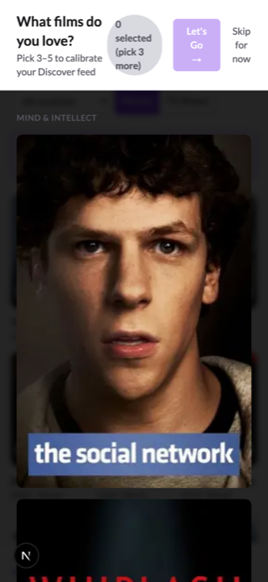

**Why it matters.** This is the first thing a new user does, and on a phone it looks broken and takes a long time. They can't see the categories or how many films there are, and have to scroll through roughly 8 screens per category.

### F2. No film titles on touch screens, and copy that doesn't match behaviour: High · effort S

**Observed.**
- The title only appears in a hover overlay (`OnboardingModal.tsx:186`, `group-hover`). Phones have no hover, so users have to recognise each film from its poster art.
- The header says "Pick 3–5", but the modal has no maximum. My test selected 6 and the counter read "6 selected" (`toggle`, `:38`). The unused `/onboarding` page does cap at 5 (`app/onboarding/page.tsx:52`).
- The prompt asks "What films do you love?" and only offers movies. The app is half TV (TV tab, "My TV"), and the picks feed only the movie Discover feed.
- The subtitle says "calibrate your Discover feed", which is jargon.

| Desktop (no titles until hover) | Phone after picking (counter only, no max) | First landing after picks |
|---|---|---|
| 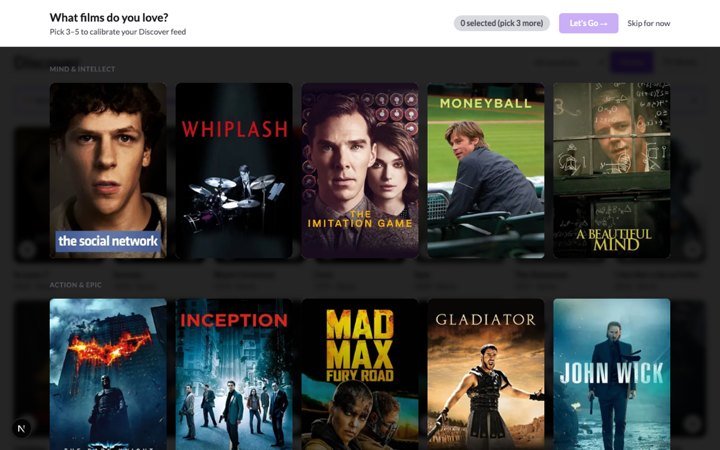 | 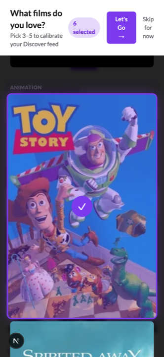 | 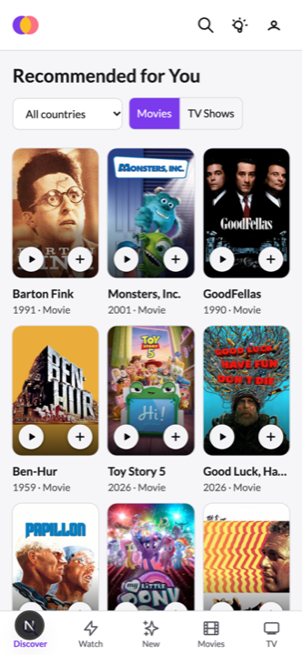 |

### F3. One curated tile is the wrong film: Medium · effort S

**Observed.** `lib/onboarding.ts` lists `{ id: 264644, title: "Ex Machina" }` in Sci-Fi, but TMDB id 264644 is ***Room*** (2015). I checked all 40 ids against the TMDB API, and this is the only mismatch. The tile shows *Room*'s poster (visible in `onboarding/orphan-onboarding-page.png`, Sci-Fi row, 4th). A user who picks it gets *Room* saved as watched and loved (see F9). Ex Machina's TMDB id is 264660.

### F4. Sign-in has three entry pages, and all of them greet people as returning users: Medium · effort S

**Observed.**
- Landing "Get Started" → `/register` ("Create Account") shows exactly the same single Google button as `/login`. `RegisterForm` just renders `LoginForm` (`components/auth/RegisterForm.tsx:10`). That's an extra page and tap that does nothing different.
- `/login` says **"Welcome back."** to everyone (`app/(auth)/login/page.tsx:61`). It's the page every deep link and every invitee lands on, and most of them are new.
- The `/register` subtitle "Start tracking your movie watchlist" leaves out TV.

| Landing | Register | Login |
|---|---|---|
| 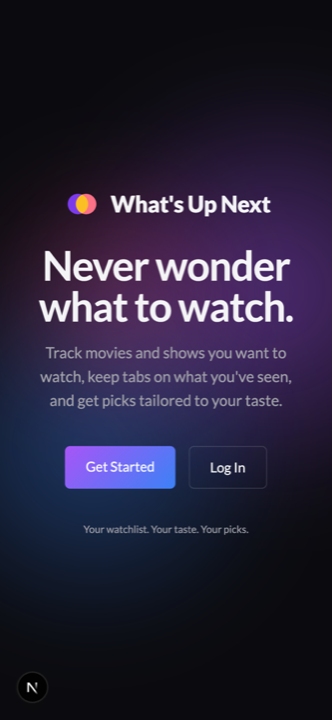 | 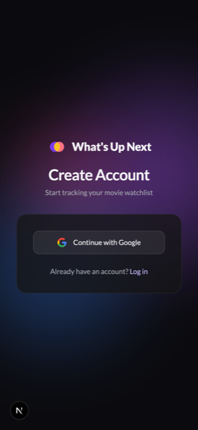 | 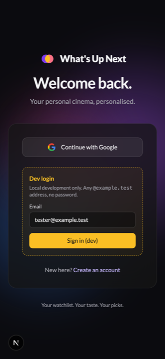 |

### F5. A signed-out Watch Together link loses its context: Medium · effort S (copy) / M (behaviour)

**Observed.**
1. `/watch-together/<id>` while signed out → `/login?callbackUrl=%2Fwatch-together%2F…` (#159 works), but the page says "Welcome back." with nothing about who invited them or why.
2. "Create an account" on that page links to plain `/register`, so **the callbackUrl is dropped** (`app/(auth)/login/page.tsx:90`; `RegisterForm` doesn't accept a callbackUrl at all). A new user who takes the obvious "I don't have an account" route ends up on Discover, not the shared page.
3. After signing in from the login page directly, a new user (not a friend of the sender) lands on plain `/what-to-watch`, with only a generic "Add a friend in Profile to watch together" link. Nothing says the link was for watching with a specific person, or that they need to connect first.
4. The onboarding modal **doesn't appear** on that path, because it only mounts on `/search` (`app/(main)/search/page.tsx:163`). It pops up later, out of context, the first time they open Discover (confirmed: shown on the later `/search` visit).

| Signed-out link | After sign-in |
|---|---|
| 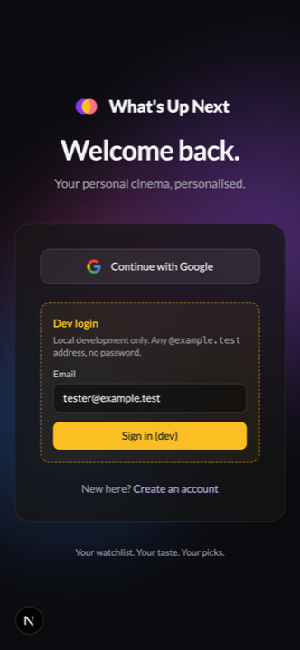 | 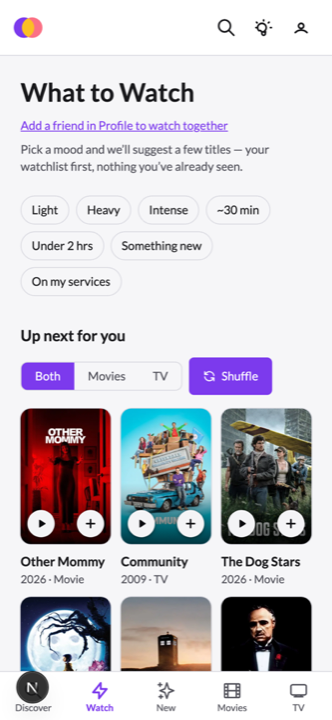 |

### F6. Invited friends never see the invite: Medium · effort S–M

**Observed.** The invite (#160) is converted into a pending friend request at sign-in (`lib/auth.ts:39`). But:
- The invite email links to the site root, `https://whatsupnext.site` (`lib/invites.ts:27-28`), so the invitee goes through the generic landing → register → login path.
- After onboarding, the invitee's first screen (Discover) shows **nothing** about the request. My check for "request / pending / invited" text on the landing page found 0 matches. The request only shows inside Profile, which they have no reason to open.

So the social reason they joined is invisible. They have to guess that Profile holds it.

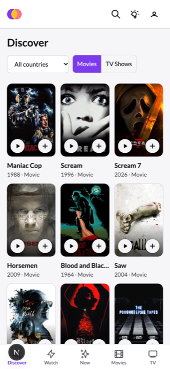

### F7. Skipping the picker late in the evening shows horror: Medium · effort S

**Observed.** With no picks, Discover falls back to `/api/movies/contextual`, which chooses genres by **UTC hour** (`app/api/movies/contextual/route.ts:15`). UTC 00–05 is "Late Night" (Horror, Mystery, Crime). My run at 22:08 EST (03:08 UTC) showed *Maniac Cop, Scream, Scream 7, Horsemen, Saw…* to a brand-new user (screenshot above). For US users, that's every evening from about 19:00–20:00 local onward, which is exactly when people try the app. In the UK it's midnight to 05:00.

**Suspect:** this may be part of what made the experience "horrible" if Laura skipped the picker. Her notes should say.

### F8. Two diverging copies of the picker, one of them unreachable: Low (maintenance) · effort S

**Observed.** `app/onboarding/page.tsx` is a full-page picker that nothing in the app links to or redirects to (grep shows no `/onboarding` route references outside itself). It differs from the modal: it caps picks at 5, uses `grid-cols-5` (five tiny posters per row on a phone), and has a different counter. Any fix applied to one copy won't reach the other. The full-page version is the better shape (see the proposal); the modal is what users actually see.

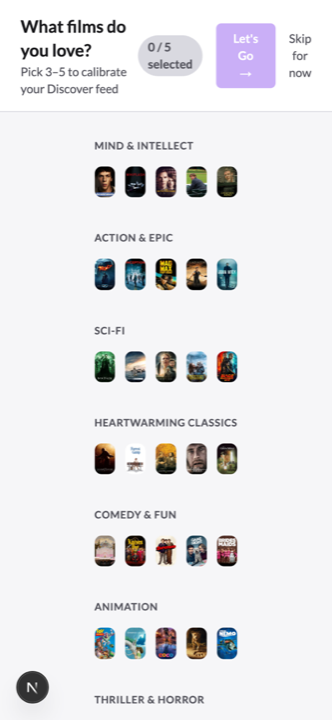

### F9. What the picks write may surprise users: Low–Medium · effort S (but needs a decision)

**Observed.** Each pick is saved as `status: WATCHED, rating: 3` (❤️ on the 1–3 scale), with `watchedAt: now` (`app/api/onboarding/route.ts:47-55`). A new user's "My Movies" therefore opens with 3–5 films "watched today" that they only tapped as "films I love".

**Suspect:** fine for taste, odd for history. The owner should decide whether picks should be rated-only (taste signal) instead of being added to Watched.

### F10. Failures are silent, and the modal isn't a real dialog: Low · effort S

**Observed.**
- `submit` ignores a non-OK response and closes the modal anyway (`OnboardingModal.tsx:51-60`). A 500 there looks like success, and the user is asked again later.
- Poster loading has no error or loading state. If TMDB fails, the tiles fall back to plain titles with no explanation. `/api/onboarding/movies` makes 40 TMDB detail calls per open (about 0.8–1.1 s locally).
- No `role="dialog"`/`aria-modal`, no focus trap, and Escape doesn't close it (verified). Tiles have no `aria-pressed`, so screen readers don't hear which tiles are selected.

## Proposed new flow (short)

1. **Landing → one sign-in page.** "Get started" and "Log in" both go to `/login`, with neutral copy ("Sign in or create an account with Google"). `/register` redirects there and keeps `callbackUrl`.
2. **Google.**
3. **First sign-in always goes through `/onboarding?next=<callbackUrl>`**: a full page, not a modal. Every deep link and invite passes through it once, then continues to where the user was going.
   - Phone-first: a 3-column grid of about 18–24 titles (fewer and broader, **movies and TV mixed**), each with its title visible under the poster.
   - A sticky bottom bar: "Pick 3 · 1 of 3 ✓ — Continue". "Skip" in the top corner at full touch size.
4. **If they were invited, the next screen says so**: "Alex wants to share what to watch with you — Accept". Show it as a card on the first landing, not hidden in Profile.
5. **First landing is the destination** (Watch Together link, invite or Discover). If they skipped the picker, show broadly popular titles, not time-of-day genres.

Target: **5–6 taps, at most 2 screens of scrolling on a phone**.

## Proposed follow-ups

These are listed in the PR body as factory issues (not created here), ordered so the quick wins land first. **Owner decisions** are marked.

## Sources

- Code references are to `main` at `b1d9716`.
- TMDB id check: TMDB API `GET /3/movie/{id}` for all 40 curated ids, 2026-11-27.
- Touch-target guideline: WCAG 2.2 Success Criterion 2.5.8 Target Size (Minimum), https://www.w3.org/TR/WCAG22/#target-size-minimum (24 px minimum); Apple Human Interface Guidelines recommend 44×44 pt.
